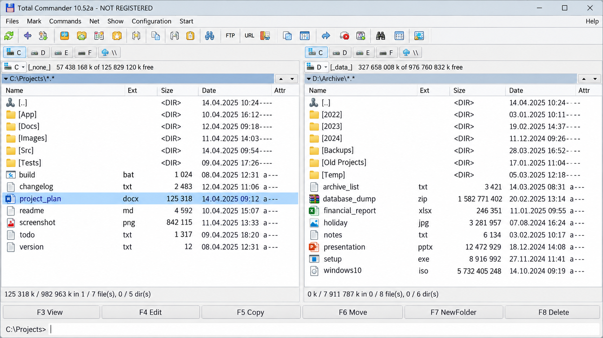
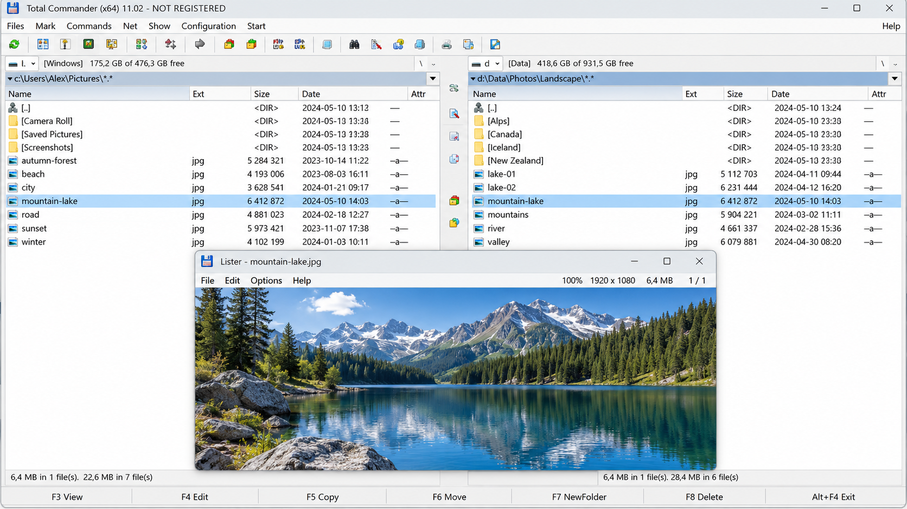
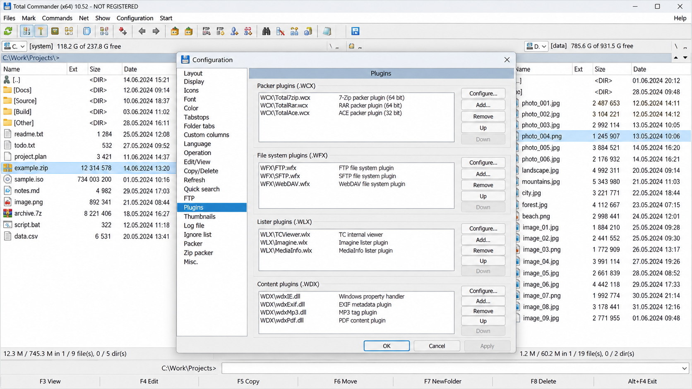

# Total Commander File Manager - A Dual-Pane File Manager For Windows

Total Commander File Manager is a community-maintained Windows file-management repository from Total Commander Plugins. It focuses on fast navigation, tabs, bookmarks, search, bulk renaming, previews, keyboard-driven workflows, and familiar dual-pane concepts inspired by Total Commander.

This repository is not the official Total Commander source tree or installer. The retained C++ code concentrates on the Windows shell, interface, navigation, and file-operation layers.

## What is Total Commander?

Total Commander is a classic two-panel file manager originally released as Windows Commander. It provides direct keyboard commands for copying, moving, searching, renaming, comparing directories, synchronizing folders, opening archives, and transferring files through FTP.

Total Commander File Manager presents a related Windows desktop codebase maintained under Total Commander Plugins. The selected files cover the address bar, browser panes, tabs, bookmarks, shell integration, file operations, search, themes, and supporting tests. Total Commander license and Total Commander price information for the commercial application should be verified through the Total Commander official site.

## Features

### Portable

- Total Commander portable workflows support file management without depending on the standard Windows Explorer layout.
- Total Commander 64 bit usage is suited to current Windows systems.
- Total Commander Windows 11 and Total Commander for Windows 10 searches reflect the primary desktop audience.
- Configuration and project metadata remain compact and visible in [CMakeLists.txt](CMakeLists.txt), [Explorer++.sln](Explorer++.sln), and [Explorer++.vcxproj](Explorer++.vcxproj).

### Navigation

- Browser windows and panes are implemented through [BrowserWindow.cpp](src/BrowserWindow.cpp), [BrowserPane.cpp](src/BrowserPane.cpp), and [BrowserView.cpp](src/BrowserView.cpp).
- Address navigation is handled by [AddressBar.cpp](src/AddressBar.cpp).
- Tabs use [Tab.cpp](src/Tab.cpp), [TabContainer.cpp](src/TabContainer.cpp), and [TabRestorer.cpp](src/TabRestorer.cpp).
- Bookmark structures are represented by [BookmarkItem.cpp](src/BookmarkItem.cpp) and [BookmarkTree.cpp](src/BookmarkTree.cpp).
- Tree and list navigation are covered by [TreeView.cpp](src/TreeView.cpp) and [ListView.cpp](src/ListView.cpp).

### Search

- Total Commander file search behavior is represented by [SearchDialog.cpp](src/SearchDialog.cpp).
- Total Commander everything integration describes the application’s established high-speed search workflow with external indexing.
- Directory monitoring is supported by [DirectoryWatcherFactoryImpl.cpp](src/DirectoryWatcherFactoryImpl.cpp) and [FileSystemWatcher.cpp](src/FileSystemWatcher.cpp).
- Total Commander compare directories and Total Commander directory synchronization remain important application workflows, although dedicated synchronization modules are not part of this retained file set.

### Convenience

- Total Commander keyboard shortcuts support efficient command-driven navigation and file operations.
- Total Commander quick view provides rapid inspection of selected files.
- Bulk renaming is represented by [MassRenameDialog.cpp](src/MassRenameDialog.cpp) and [MassRenameHelper.cpp](src/MassRenameHelper.cpp).
- Clipboard and drag-and-drop behavior use [Clipboard.cpp](src/Clipboard.cpp) and [DragDropHelper.cpp](src/DragDropHelper.cpp).
- Core operations are organized in [FileOperations.cpp](src/FileOperations.cpp).
- Menus, toolbars, and status information use [MainMenu.cpp](src/MainMenu.cpp), [MainToolbar.cpp](src/MainToolbar.cpp), and [StatusBar.cpp](src/StatusBar.cpp).
- Total Commander archive support and the Total Commander FTP client are established application features, while this repository selection focuses on the shell and interface core.
- Total Commander webdav and Total Commander google drive functionality normally depend on protocol extensions or Total Commander Plugins outside this retained source set.

### Is Total Commander better than Explorer?

Total Commander is better suited to users who regularly copy, move, compare, rename, synchronize, or inspect large groups of files. Its dual-pane layout keeps the source and destination visible, while keyboard commands reduce repeated navigation.

Windows Explorer remains simpler for occasional browsing and standard Windows tasks. Total Commander File Manager is more compelling when tabs, bookmarks, batch operations, configurable views, and predictable keyboard workflows matter. The better choice therefore depends on whether simplicity or advanced file management is the priority.

## Non-Features

- This repository does not contain the proprietary Total Commander desktop source code.
- This repository does not provide an official Total Commander APK.
- Total Commander Plugins not represented by the retained files are not bundled.
- Protocol implementations for Total Commander webdav, Total Commander google drive, and remote cloud storage are not included.
- Built binaries, installers, translation packs, and third-party archive libraries are not retained.

## Where to start

### Download

### Is the Total Commander app safe?

The official Total Commander application is generally considered safe when obtained from its official distribution channel. Users should avoid modified installers, cracked releases, and unverified Total Commander APK packages because those files can be altered by third parties.

Total Commander File Manager contains reviewable C++ source rather than an opaque bundled installer. Security-sensitive behavior can be inspected in [ShellContextMenu.cpp](src/ShellContextMenu.cpp), [CommandLine.cpp](src/CommandLine.cpp), and [Application.cpp](src/Application.cpp). The repository also retains tests for clipboard, drag-and-drop, navigation, shell behavior, and file-system watching, but source availability does not replace local build verification and malware scanning.

### How This Repository Is Described

total commander file manager, total commander plugins, total commander for windows, total commander dual pane file manager, total commander archive support, file-manager, dual-pane, windows, desktop-application, file-management, archive-manager, ftp-client

## Installing and running Total Commander File Manager

The Total Commander File Manager repository is organized as a native Windows C++ project. The Visual Studio entry point is [Explorer++.sln](Explorer++.sln), while [CMakeLists.txt](CMakeLists.txt) provides the CMake project definition.

The application entry and resources are represented by [Explorer++.cpp](src/Explorer++.cpp), [Explorer++.h](src/Explorer++.h), [Explorer++.rc](src/Explorer++.rc), and [Explorer++VersionInfo.rc](src/Explorer++VersionInfo.rc). Runtime window behavior is supported by [WindowHelper.cpp](src/WindowHelper.cpp), while appearance handling uses [Theme.cpp](src/Theme.cpp) and [DarkModeManager.cpp](src/DarkModeManager.cpp).

### Is Total Commander available on Linux?

The official desktop version of Total Commander is designed for Windows, and there is no native Total Commander for Linux release represented here. Searches for Total Commander Ubuntu usually concern compatibility layers, remote access, or file managers with a similar dual-pane workflow.

Total Commander File Manager also retains Windows-specific project and shell files, so it should not be presented as a native Linux build. Total Commander OSX searches have the same limitation because this repository does not contain a native macOS target. Total Commander Android is a separate mobile edition and is not built from this Windows C++ project.

## Building from source

### Prerequisites

- A Windows C++ development environment.
- Visual Studio support for native desktop projects.
- CMake when using [CMakeLists.txt](CMakeLists.txt).
- Git for source management.

### Code Editing

The main implementation is under `src`, with interfaces stored beside their corresponding C++ files. Formatting conventions are defined in [.clang-format](.clang-format) and [.editorconfig](.editorconfig).

The Total Commander File Manager architecture separates navigation, shell browsing, file operations, tabs, bookmarks, themes, and dialogs. Total Commander Plugins should remain isolated from core navigation where possible, following the extension-oriented design used by established file managers.

### How to Run

Open [Explorer++.sln](Explorer++.sln) in Visual Studio, select the required architecture, build the solution, and start the generated desktop target. The repository also exposes [CMakeLists.txt](CMakeLists.txt) for compatible CMake workflows.

### How to Debug

Start a debug build through the selected Visual Studio configuration. Navigation failures can be traced through [NavigationManager.cpp](src/NavigationManager.cpp) and [NavigationHelper.cpp](src/NavigationHelper.cpp), while shell-view issues can be followed through [ShellBrowser.cpp](src/ShellBrowser.cpp) and [ShellView.cpp](src/ShellView.cpp).

## Documentation

The source tree is intentionally small enough to navigate directly. Header and implementation pairs document the boundaries between application, browser, navigation, file-operation, and interface components.

| Area | Implementation | Verification |
|---|---|---|
| Address navigation | [AddressBar.cpp](src/AddressBar.cpp) | [AddressBarTest.cpp](tests/AddressBarTest.cpp) |
| Application lifecycle | [Application.cpp](src/Application.cpp) | [ApplicationTest.cpp](tests/ApplicationTest.cpp) |
| Bookmarks | [BookmarkTree.cpp](src/BookmarkTree.cpp) | [BookmarkTreeTest.cpp](tests/BookmarkTreeTest.cpp) |
| Browser windows | [BrowserWindow.cpp](src/BrowserWindow.cpp) | [BrowserWindowTest.cpp](tests/BrowserWindowTest.cpp) |
| Clipboard | [Clipboard.cpp](src/Clipboard.cpp) | [ClipboardTest.cpp](tests/ClipboardTest.cpp) |
| File watching | [FileSystemWatcher.cpp](src/FileSystemWatcher.cpp) | [FileSystemWatcherTest.cpp](tests/FileSystemWatcherTest.cpp) |
| Bulk rename | [MassRenameHelper.cpp](src/MassRenameHelper.cpp) | [MassRenameHelperTest.cpp](tests/MassRenameHelperTest.cpp) |
| Navigation | [NavigationManager.cpp](src/NavigationManager.cpp) | [NavigationManagerTest.cpp](tests/NavigationManagerTest.cpp) |
| Shell browsing | [ShellBrowser.cpp](src/ShellBrowser.cpp) | [ShellBrowserTest.cpp](tests/ShellBrowserTest.cpp) |
| Tabs | [TabContainer.cpp](src/TabContainer.cpp) | [TabContainerTest.cpp](tests/TabContainerTest.cpp) |

## Contribution

Total Commander Plugins welcomes focused changes to Total Commander File Manager. Proposed work should preserve the compact Windows C++ scope, follow the existing formatting files, and include tests where the retained test structure allows them.

Changes to tabs should consider [TabRestorerTest.cpp](tests/TabRestorerTest.cpp). Changes to list rendering should consider [ListViewTest.cpp](tests/ListViewTest.cpp). Changes to context-menu behavior should consider [ShellContextMenuBuilderTest.cpp](tests/ShellContextMenuBuilderTest.cpp). Theme-related changes should consider [ThemedTabControlPainterTest.cpp](tests/ThemedTabControlPainterTest.cpp).

## About

Total Commander File Manager is maintained as a community repository under the Total Commander Plugins organization. Its selected files preserve a compact native Windows file-manager core influenced by the workflows associated with Total Commander, Windows Commander, and `totalcmd`.

Repository terms are recorded in [LICENSE](LICENSE). The Total Commander license for the commercial application is separate from this repository’s licensing and distribution terms.
